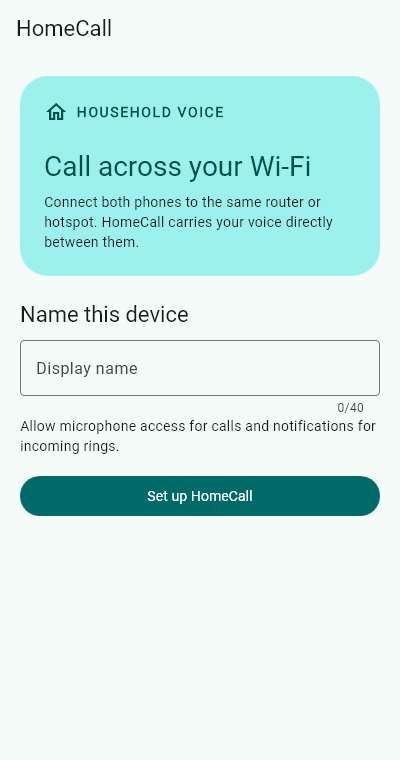

# HomeCall

**Offline voice calls between Android phones on the same Wi-Fi network or hotspot.** Each phone discovers its neighbors, verifies the other phone's identity and exchanges encrypted signaling directly. No account, SIM, internet connection or household server is required at runtime.

| Build | Android | Verification |
| --- | --- | --- |
| Flutter 3.41.3 · Dart 3.11.1 | API 26+ · Kotlin · self-managed Telecom | Debug APK compiled · 10 Flutter tests and a native two-peer TLS test passed · two-phone audio acceptance pending |

## Version 1.0.1


Update both phones together. This version uses the existing device identity to authenticate a separate Android TLS key. It selects the local Wi-Fi route and also discovers peers through a small UDP broadcast when DNS-SD misses them. Keep both apps open for the first check. Allow about 10 seconds, then try **Pair by local IP** using the address displayed on the other phone. Manual lookup shows the underlying connection error.

## Try a call on two phones

1. Install the debug APK on both phones using the steps below. Connect both to the same router. For the offline test, disconnect the router's WAN cable and turn off mobile data on both phones.
2. Open HomeCall on each phone, enter distinct names, and grant microphone and notification access. Keep both apps visible for the first call.
3. Tap **Pair** beside the other phone. On that phone open **Settings** and compare **all four groups** of its identity code with the pairing dialog. Tap **Codes match** only after comparing. Repeat the pairing in the opposite direction.
4. Tap the call button beside the online paired device. Answer on the other phone. Speak in both directions, toggle mute and speaker, then hang up.
5. For hotspot testing, enable the access point on one Android phone with mobile data disabled. Join it from the other phone. Repeat the test, reversing which device initiates the call. Some hotspot implementations isolate clients or restrict access to the host.



*Rendered from the application’s onboarding widget. Device-specific notification and lock-screen appearance require a phone.*

## Build and install

Install the Flutter 3.41.3 stable SDK, add its bin directory to PATH, and install Android Studio with a JDK compatible with Gradle 8.14 (JDK 17 or 21). Install Android SDK Platform 36, Platform 35 if requested by plugins, Build-Tools, Platform-Tools, Command-line Tools and the NDK version requested by Gradle. The build machine needs internet for the initial package and SDK downloads. [Flutter Android setup](https://docs.flutter.dev/platform-integration/android/setup)

Clone HomeCall from GitHub and run the following commands. If you already have the project open, start at `flutter doctor -v`.

```powershell
git clone https://github.com/AREEB-AZHAR/HomeCall.git
cd HomeCall
flutter doctor -v
flutter doctor --android-licenses
flutter pub get
flutter analyze
flutter test
flutter build apk --debug
```

Flutter writes machine-specific SDK locations into the ignored Android local.properties file. If Flutter cannot locate your SDK or Gradle JDK, run `flutter config --android-sdk "PATH_TO_ANDROID_SDK"` and `flutter config --jdk-dir "PATH_TO_JDK"`. On this development machine Gradle built successfully even though Flutter Doctor reported missing command-line tools and unknown license status.

The installable artifact is `build/app/outputs/flutter-apk/app-debug.apk`. Enable Developer options and USB debugging on each test phone. Accept the USB authorization prompt, add the Android SDK platform-tools folder to PATH, then run:

```sh
adb devices -l
adb -s SERIAL_A install -r build/app/outputs/flutter-apk/app-debug.apk
adb -s SERIAL_B install -r build/app/outputs/flutter-apk/app-debug.apk
```

Replace SERIAL_A and SERIAL_B with the actual IDs. Open HomeCall from each launcher. For an attached development session, run `flutter run -d SERIAL_A`.

### Build output

Flutter reports the number of unused Material Icons removed from a release. Keeping this optimization produces a smaller APK. HomeCall compiles the WebRTC plugin with Java and Kotlin target 17. Its upstream Java code still uses deprecated APIs and unchecked operations. Normal builds omit the vendor notes. To inspect individual diagnostics, run `gradlew.bat :flutter_webrtc:compileReleaseJavaWithJavac -PhomecallVendorLint=true` from the Android directory on Windows.

### Signed release

Create a private upload keystore with Android Studio or keytool. Create the ignored `android/key.properties` with `storeFile`, `storePassword`, `keyAlias` and `keyPassword` on separate lines as key=value properties. Use an absolute path with forward slashes for storeFile. Secure both files outside source control. Run `flutter build apk --release` to produce the release APK after configuring signing. This checkout was delivered with a debug APK.

## Troubleshooting

| Symptom | First check |
| --- | --- |
| Empty list | Open both apps, check the local IPv4 addresses, and tap Refresh. Use **Pair by local IP** with the address shown on the remote phone |
| Direct IP also fails | Check guest/client isolation, VPN routing and firewall access to TCP 43871. Try a regular home router |
| Peer is visible but the call times out | Verify pairing on **both** phones. Check clocks are within two minutes. Confirm microphone permission and reachable UDP media paths |
| Device identity changed | After reinstalling or clearing app data, forget the old device and verify the new identity code |
| Background call is silent | Verify a foreground call first. Check the availability notification, incoming channel sound, DND, lock-screen permissions and OEM battery settings. Reopen after force-stop or reboot |
| No audio after acceptance | Check mute, headset route and microphone permission on both phones. Repeat on a non-isolated router and record Android versions |

## Source map and engineering notes

- `lib/app.dart` contains the Material 3 setup, device list, pairing, call and settings screens.
- `lib/core/` validates the wire protocol. `lib/features/` manages SQLite, peers, call state and WebRTC audio.
- `android/app/src/main/kotlin/dev/homecall/homecall/` implements Keystore-backed TLS, DNS-SD, the shared Flutter engine, Telecom and foreground notifications.
- `test/` contains host-side tests. `integration_test/` contains a device-only audio and identity smoke test. `tool/` contains the screenshot capture.

Read [architecture](docs/ARCHITECTURE.md), [network protocol](docs/NETWORK_PROTOCOL.md), [security and pairing](docs/SECURITY.md), [Android background behavior](docs/ANDROID_BACKGROUND_CALLING.md), [test procedures and results](docs/TESTING.md), and [known limitations](docs/KNOWN_LIMITATIONS.md).

**Next milestone.** Run the two-phone offline audio check first, followed by hotspot host/client, locked-screen answer and accessory routing. Record those results before signing a release.
